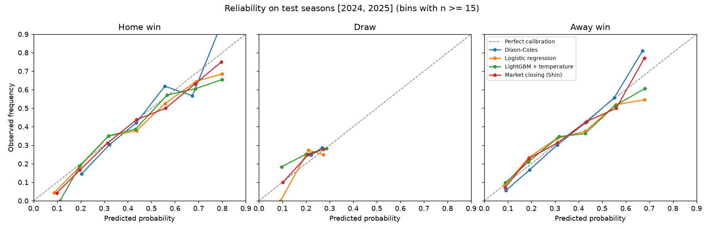

# PitchIQ: Premier League match probabilities vs the betting market

**Can a model built from free public data produce calibrated Home/Draw/Away probabilities that get close to the bookmakers' closing line, and what does the remaining gap tell us?**

PitchIQ builds Elo ratings from scratch and engineers leakage-checked features from 10+ seasons of results and xG. It compares a Dixon-Coles goals model, logistic regression and LightGBM in walk-forward backtests against margin-free bookmaker probabilities, explains predictions with SHAP, and simulates the rest of the season 10,000 times.

🔗 **Live app:** _add your Streamlit link here_ · 📝 **Write-up:** _add blog link_

> Not betting advice. The app shows no odds or betting signals for upcoming games.

---

## Results

> **Fill this section from `reports/results.md` after your first real run.** Every number must come from that file. The pipeline generates it, so nothing here is typed by hand.

| Model (test seasons 2024/25 + 2025/26) | Log loss | Brier | RPS | Accuracy |
|---|---|---|---|---|
| Base rates | – | – | – | – |
| Dixon-Coles | – | – | – | – |
| Logistic regression | – | – | – | – |
| LightGBM + temperature | – | – | – | – |
| **Bookmaker closing (Shin, margin removed)** | – | – | – | – |

Gap to the closing market (paired bootstrap, 95% CI): _from `artifacts/bootstrap_vs_market.csv`_



## Problem

Predict P(home win), P(draw) and P(away win) for every EPL match **using only information available before kickoff**, so that the probabilities are *calibrated*: a 60% call should win about 60% of the time. Bookmakers' closing odds are the benchmark because they combine all public information, which makes them very hard to beat.

## Data

| Source | What | Seasons | Notes |
|---|---|---|---|
| [football-data.co.uk](https://www.football-data.co.uk) | Results, shots, bookmaker odds (pre-match + closing) | 2005/06 → today | Column guide in `notes.txt` on their site |
| [Understat](https://understat.com) | Match xG | 2014/15 → today | xG comes from Understat's own model |

Collection is deliberately polite: completed seasons are downloaded once and cached, only the current season refreshes, Understat requests are 3 s apart, and raw data is **not** committed to this repo. See `reports/cleaning_log.md` for every row the cleaning touched.

## Method

1. **Pipeline:** download, clean and join on (season, home, away), with an explicit team-name map that fails loudly. → `src/pitchiq/data/`
2. **Elo from scratch:** goal-margin multiplier, summer regression to the mean, promoted sides start at the relegated sides' level. K, home advantage and regression tuned on 2008–2019 only. → `ratings/elo.py`
3. **Features:** form, EWM goals/xG/shots for and against, venue form, rest days, promoted flag, head-to-head, Elo. Every feature is looked up *strictly before* the match date. A **perturbation test** scrambles all results from a date onward and asserts that day's features don't change. A deliberately leaky version is caught in the tests. → `features/`
4. **Baselines:** always-home, base rates, Elo-only logistic, independent Poisson, and **Dixon-Coles** (time-decayed, weekly refit, low-score correction). → `models/dixon_coles.py`
5. **ML:** multinomial logistic regression and **LightGBM** with temperature scaling. **Walk-forward** validation: each season is predicted by models trained only on earlier seasons. → `models/ml.py`
6. **Evaluation:** log loss, Brier, RPS, accuracy, ECE and reliability plots. Every model is scored on the same matches against **bookmaker probabilities with the margin removed** (proportional and Shin's method), with paired-bootstrap confidence intervals. → `evaluation/`
7. **Draws:** why they're almost never the most likely outcome, where they cluster, and whether a draw threshold helps. → `analysis/draws.py`
8. **SHAP:** global importance and per-fixture "why" explanations. → `explain/`
9. **Season simulator:** 10,000 Monte Carlo seasons from Dixon-Coles scorelines **with parameter uncertainty** → title / top-4 / relegation odds. → `simulate/`
10. **App + ops:** Streamlit app, Docker image, CI, and a weekly GitHub Actions refresh that commits new predictions.

## Limitations (honest list)

- No team news: lineups, injuries and suspensions are a big part of what the market knows and the model doesn't.
- Rest days count league games only; cup and European fixtures are missing.
- xG is a third-party model's output, not ground truth.
- Promoted teams early in the season have little data. They're shrunk toward the weakest established teams, which is a modelling assumption.
- About 760 test matches is a small sample for detecting log-loss differences of around 0.005. That's why the bootstrap CIs are there.

## How to run

```bash
python -m venv .venv
.venv\Scripts\activate            # Windows   (macOS/Linux: source .venv/bin/activate)
pip install -r requirements.txt
pip install -e . --no-deps

python -m pitchiq.pipeline all     # first run: download → tune → backtest → live → report (~10 min)
pytest -q                          # tests, incl. an end-to-end run on synthetic data
streamlit run app/streamlit_app.py # the app, reading artifacts/
```

Weekly: `python -m pitchiq.pipeline refresh` (GitHub Actions does this every Tuesday).
Offline demo without touching the websites: `make synthetic` (outputs are clearly labelled synthetic).

Deployment (free): see [docs/DEPLOY.md](docs/DEPLOY.md). Full walkthrough with design reasoning and interview prep: [docs/WALKTHROUGH.md](docs/WALKTHROUGH.md).

## Repo layout

```
src/pitchiq/
  data/        fetch.py · clean.py · merge.py · team_names.py · synthetic.py
  ratings/     elo.py
  features/    build.py · leakage.py
  models/      dixon_coles.py · ml.py
  evaluation/  metrics.py · backtest.py
  analysis/    draws.py
  explain/     shap_explain.py
  simulate/    season.py
  pipeline.py  report.py  config.py
app/           streamlit_app.py (reads artifacts/ only)
notebooks/     01_data_audit · 02_elo_and_features · 03_results
tests/         unit + integration (synthetic data, leakage, simulator, end-to-end)
artifacts/     small committed outputs the app reads
reports/       results.md, cleaning log, tuning grids, figures
DECISIONS.md   every design choice and why
```

## Credits

Data: football-data.co.uk and Understat. Dixon & Coles (1997), *Modelling Association Football Scores and Inefficiencies in the Football Betting Market*. Shin (1993) on bookmaker margins.
