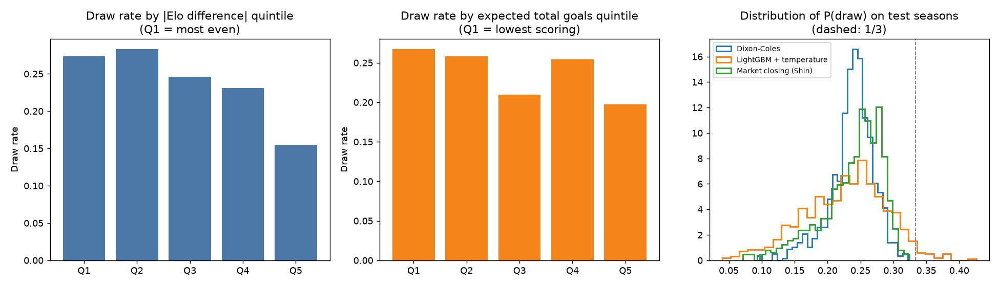
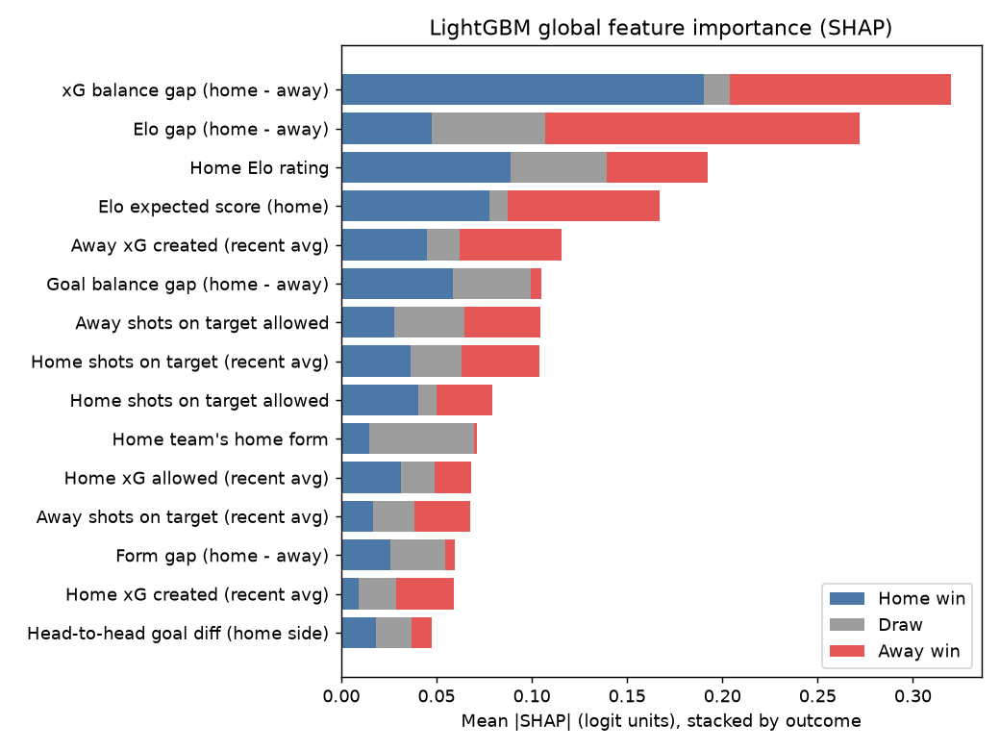
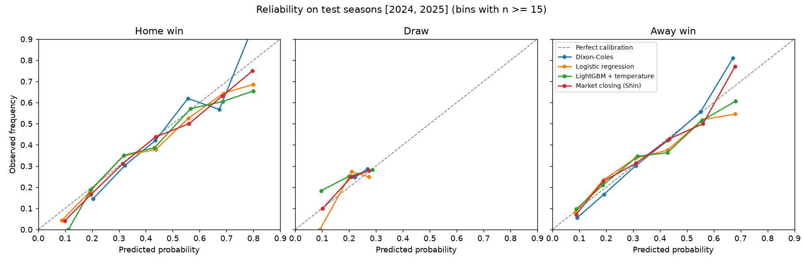

# PitchIQ — results

_Generated 2026-10-31T18:04+00:00 · data through 2026-10-25_

## Tuned parameters

- Elo: K = 10, home advantage = 75 pts, summer regression = 0.1
- Logistic regression: {'C': 0.01}
- LightGBM: {'n_estimators': 150, 'num_leaves': 7, 'min_child_samples': 100}

## Leakage check

Perturbation test passed on 7 dates (8 matches): scrambling every result from a date onward changed none of that date's features.

## Backtest — test seasons [2024, 2025]

Walk-forward: each season predicted by models trained only on earlier seasons. All models scored on the same matches. Lower is better except accuracy.

| model | log_loss | brier | rps | accuracy | ece | n |
|---|---|---|---|---|---|---|
| Always home | — | — | — | 0.4171 | — | 760 |
| Base rates | 1.0824 | 0.6558 | 0.2315 | 0.4171 | 0.0200 | 760 |
| Elo-logit | 1.0176 | 0.6122 | 0.2097 | 0.4908 | 0.0411 | 760 |
| Poisson (rho=0) | 1.0076 | 0.6030 | 0.2059 | 0.5000 | 0.0288 | 760 |
| Dixon-Coles | 1.0069 | 0.6026 | 0.2058 | 0.5000 | 0.0257 | 760 |
| Logistic regression | 1.0132 | 0.6088 | 0.2074 | 0.5013 | 0.0411 | 760 |
| LightGBM | 1.0229 | 0.6123 | 0.2080 | 0.4974 | 0.0434 | 760 |
| LightGBM + temperature | 1.0219 | 0.6113 | 0.2076 | 0.4974 | 0.0393 | 760 |
| Market pre-match (prop.) | 0.9931 | 0.5945 | 0.2013 | 0.5171 | 0.0324 | 760 |
| Market closing (prop.) | 0.9901 | 0.5922 | 0.2006 | 0.5197 | 0.0286 | 760 |
| Market closing (Shin) | 0.9906 | 0.5926 | 0.2008 | 0.5197 | 0.0271 | 760 |

## Backtest — validation seasons [2020, 2021, 2022, 2023]

Walk-forward: each season predicted by models trained only on earlier seasons. All models scored on the same matches. Lower is better except accuracy.

| model | log_loss | brier | rps | accuracy | ece | n |
|---|---|---|---|---|---|---|
| Always home | — | — | — | 0.4382 | — | 1520 |
| Base rates | 1.0659 | 0.6454 | 0.2358 | 0.4382 | 0.0146 | 1520 |
| Elo-logit | 0.9777 | 0.5788 | 0.2034 | 0.5467 | 0.0216 | 1520 |
| Poisson (rho=0) | 0.9743 | 0.5782 | 0.2028 | 0.5434 | 0.0183 | 1520 |
| Dixon-Coles | 0.9749 | 0.5785 | 0.2028 | 0.5434 | 0.0196 | 1520 |
| Logistic regression | 0.9761 | 0.5778 | 0.2025 | 0.5428 | 0.0251 | 1520 |
| LightGBM | 0.9819 | 0.5811 | 0.2027 | 0.5408 | 0.0275 | 1520 |
| LightGBM + temperature | 0.9824 | 0.5827 | 0.2036 | 0.5408 | 0.0320 | 1520 |
| Market pre-match (prop.) | 0.9542 | 0.5645 | 0.1963 | 0.5599 | 0.0207 | 1520 |
| Market closing (prop.) | 0.9489 | 0.5609 | 0.1945 | 0.5612 | 0.0211 | 1520 |
| Market closing (Shin) | 0.9486 | 0.5607 | 0.1945 | 0.5612 | 0.0201 | 1520 |

Average bookmaker margin (overround) removed: pre-match 4.15%, closing 3.64%.

## Gap to the closing market (test seasons, paired bootstrap 95% CI)

Mean per-match log-loss difference vs Market closing (Shin). Negative = beats the market; a CI that includes 0 means no detectable difference.

| model | diff_vs_market | ci_low | ci_high |
|---|---|---|---|
| Market closing (prop.) | -0.0004 | -0.0015 | 0.0006 |
| Market pre-match (prop.) | 0.0025 | -0.0024 | 0.0075 |
| Dixon-Coles | 0.0163 | 0.0033 | 0.0286 |
| Poisson (rho=0) | 0.0171 | 0.0040 | 0.0293 |
| Logistic regression | 0.0226 | 0.0084 | 0.0356 |
| Elo-logit | 0.0270 | 0.0138 | 0.0396 |
| LightGBM + temperature | 0.0313 | 0.0145 | 0.0476 |
| LightGBM | 0.0324 | 0.0160 | 0.0481 |
| Base rates | 0.0919 | 0.0651 | 0.1181 |

## Log loss by season

| model | 2020 | 2021 | 2022 | 2023 | 2024 | 2025 |
|---|---|---|---|---|---|---|
| Base rates | 1.0890 | 1.0695 | 1.0510 | 1.0540 | 1.0811 | 1.0838 |
| Dixon-Coles | 1.0155 | 0.9571 | 0.9929 | 0.9342 | 0.9890 | 1.0248 |
| Elo-logit | 1.0373 | 0.9509 | 0.9939 | 0.9287 | 0.9893 | 1.0458 |
| LightGBM | 1.0417 | 0.9660 | 0.9961 | 0.9239 | 0.9898 | 1.0561 |
| LightGBM + temperature | 1.0289 | 0.9749 | 0.9936 | 0.9323 | 0.9972 | 1.0465 |
| Logistic regression | 1.0384 | 0.9572 | 0.9800 | 0.9288 | 0.9821 | 1.0443 |
| Market closing (Shin) | 0.9979 | 0.9363 | 0.9620 | 0.8984 | 0.9666 | 1.0146 |
| Market closing (prop.) | 0.9971 | 0.9367 | 0.9622 | 0.8995 | 0.9664 | 1.0139 |
| Market pre-match (prop.) | 1.0059 | 0.9363 | 0.9663 | 0.9085 | 0.9703 | 1.0158 |
| Poisson (rho=0) | 1.0135 | 0.9569 | 0.9923 | 0.9346 | 0.9890 | 1.0263 |

## Draws

| model | split | actual_draw_rate | mean_pred_draw | max_pred_draw | draw_is_argmax_pct | draw_brier |
|---|---|---|---|---|---|---|
| Dixon-Coles | test | 0.2592 | 0.2374 | 0.3216 | 0.0000 | 0.1910 |
| Dixon-Coles | validation | 0.2237 | 0.2369 | 0.3445 | 0.0000 | 0.1729 |
| LightGBM + temperature | test | 0.2592 | 0.2265 | 0.4260 | 0.0118 | 0.1960 |
| LightGBM + temperature | validation | 0.2237 | 0.2508 | 0.4858 | 0.0553 | 0.1754 |
| Logistic regression | test | 0.2592 | 0.2300 | 0.3386 | 0.0000 | 0.1940 |
| Logistic regression | validation | 0.2237 | 0.2325 | 0.4010 | 0.0020 | 0.1727 |
| Market closing (Shin) | test | 0.2592 | 0.2379 | 0.3241 | 0.0000 | 0.1911 |
| Market closing (Shin) | validation | 0.2237 | 0.2375 | 0.3372 | 0.0000 | 0.1718 |
| Poisson (rho=0) | test | 0.2592 | 0.2305 | 0.3029 | 0.0000 | 0.1913 |
| Poisson (rho=0) | validation | 0.2237 | 0.2348 | 0.3366 | 0.0000 | 0.1727 |

Draw decision rule (threshold tuned on validation, scored on test):

| model | rule | threshold | accuracy | draw_recall | draw_precision | draw_f1 | draws_called |
|---|---|---|---|---|---|---|---|
| LightGBM + temperature | argmax (default) | 1.0100 | 0.4974 | 0.0102 | 0.2222 | 0.0194 | 9 |
| LightGBM + temperature | draw if P(D) >= 0.245 | 0.2450 | 0.4447 | 0.4619 | 0.2817 | 0.3500 | 323 |
| Dixon-Coles | argmax (default) | 1.0100 | 0.5000 | 0.0000 | 0.0000 | 0.0000 | 0 |
| Dixon-Coles | draw if P(D) >= 0.245 | 0.2450 | 0.4539 | 0.4924 | 0.2957 | 0.3695 | 328 |
| Market closing (Shin) | argmax (default) | 1.0100 | 0.5197 | 0.0000 | 0.0000 | 0.0000 | 0 |
| Market closing (Shin) | draw if P(D) >= 0.260 | 0.2600 | 0.4803 | 0.4213 | 0.2986 | 0.3495 | 278 |

## Explainability (LightGBM, SHAP)

| label | H | D | A | total |
|---|---|---|---|---|
| xG balance gap (home - away) | 0.1904 | 0.0134 | 0.1161 | 0.3199 |
| Elo gap (home - away) | 0.0473 | 0.0595 | 0.1654 | 0.2722 |
| Home Elo rating | 0.0887 | 0.0504 | 0.0532 | 0.1923 |
| Elo expected score (home) | 0.0776 | 0.0097 | 0.0800 | 0.1673 |
| Away xG created (recent avg) | 0.0448 | 0.0171 | 0.0537 | 0.1156 |
| Goal balance gap (home - away) | 0.0588 | 0.0406 | 0.0059 | 0.1052 |
| Away shots on target allowed | 0.0279 | 0.0369 | 0.0399 | 0.1047 |
| Home shots on target (recent avg) | 0.0363 | 0.0270 | 0.0405 | 0.1038 |
| Home shots on target allowed | 0.0404 | 0.0099 | 0.0292 | 0.0794 |
| Home team's home form | 0.0148 | 0.0548 | 0.0019 | 0.0714 |

## Season simulation (10000 runs, 300 fixtures left)

| team | played | points | exp_points | p_title | p_top4 | p_relegation |
|---|---|---|---|---|---|---|
| Arsenal | 8 | 21 | 79.2 | 51.5% | 97.3% | 0.0% |
| Man City | 8 | 21 | 77.3 | 39.7% | 95.6% | 0.0% |
| Liverpool | 8 | 15 | 64.3 | 3.8% | 55.7% | 0.1% |
| Brighton | 8 | 16 | 63.3 | 3.2% | 52.7% | 0.1% |
| Chelsea | 8 | 13 | 57.3 | 0.4% | 23.1% | 1.2% |
| Aston Villa | 8 | 11 | 53.5 | 0.1% | 12.3% | 3.6% |
| Brentford | 8 | 11 | 53.0 | 0.2% | 11.3% | 2.9% |
| Hull | 8 | 10 | 52.0 | 0.5% | 14.5% | 9.1% |
| Bournemouth | 8 | 9 | 51.7 | 0.1% | 9.3% | 5.2% |
| Newcastle | 8 | 11 | 51.5 | 0.1% | 8.1% | 5.3% |
| Leeds | 8 | 11 | 50.6 | 0.1% | 7.3% | 6.2% |
| Man United | 8 | 7 | 48.4 | 0.0% | 3.8% | 9.7% |
| Everton | 8 | 10 | 47.3 | 0.0% | 2.7% | 11.8% |
| Fulham | 8 | 8 | 44.2 | 0.0% | 1.4% | 20.0% |
| Tottenham | 8 | 9 | 43.9 | 0.0% | 1.2% | 23.2% |
| Nott'm Forest | 8 | 6 | 43.6 | 0.0% | 1.0% | 22.8% |
| Coventry | 8 | 6 | 40.8 | 0.0% | 1.6% | 40.9% |
| Crystal Palace | 8 | 7 | 40.6 | 0.0% | 0.4% | 37.8% |
| Sunderland | 8 | 5 | 39.7 | 0.0% | 0.4% | 41.9% |
| Ipswich | 8 | 10 | 36.6 | 0.0% | 0.2% | 58.3% |

